# Attack Tree: Agentic AI System Compromise

Visual decision tree of exploit paths for AI agent systems. Based on the Lilli breach attack chain and generalized threat model.

## Full Attack Tree

```mermaid
graph TD
    ROOT["🎯 Compromise AI Agent System"]

    ROOT --> RECON["1. Reconnaissance"]
    ROOT --> EXPLOIT["2. Exploitation"]
    ROOT --> PERSIST["3. Persistence"]
    ROOT --> EXFIL["4. Exfiltration"]

    %% Reconnaissance
    RECON --> R1["API Documentation<br/>Discovery"]
    RECON --> R2["Endpoint<br/>Enumeration"]
    RECON --> R3["Auth Boundary<br/>Mapping"]

    R1 --> R1a["/docs /swagger<br/>/openapi.json"]
    R1 --> R1b["Error messages<br/>leak schema"]
    R2 --> R2a["Automated scanning<br/>of all routes"]
    R3 --> R3a["Identify unauth<br/>endpoints"]
    R3 --> R3b["Test each endpoint<br/>without token"]

    %% Exploitation
    EXPLOIT --> E1["Input Injection"]
    EXPLOIT --> E2["IDOR / Access<br/>Control Bypass"]
    EXPLOIT --> E3["MCP Prompt<br/>Injection"]
    EXPLOIT --> E4["Supply Chain"]

    E1 --> E1a["SQL Injection<br/>(value params)"]
    E1 --> E1b["🔴 Field-Name<br/>Injection<br/>(Lilli vector)"]
    E1 --> E1c["NoSQL Injection"]
    E1 --> E1d["Command Injection<br/>via tool args"]

    E2 --> E2a["Sequential ID<br/>enumeration"]
    E2 --> E2b["Cross-tenant<br/>RAG access"]

    E3 --> E3a["Crafted tool<br/>response"]
    E3 --> E3b["AI executes<br/>unintended actions"]

    E4 --> E4a["Malicious npm<br/>postinstall"]
    E4 --> E4b["Poisoned repo<br/>.claude.md"]

    %% Persistence
    PERSIST --> P1["🔴 System Prompt<br/>Modification<br/>(Lilli vector)"]
    PERSIST --> P2["Config File<br/>Tampering"]
    PERSIST --> P3["Credential<br/>Harvesting"]

    P1 --> P1a["Alter AI behavior<br/>for all users"]
    P1 --> P1b["Remove guardrails"]
    P1 --> P1c["Inject exfiltration<br/>instructions"]

    P2 --> P2a["Modify SKILL.md<br/>CLAUDE.md"]
    P2 --> P2b["Alter hook<br/>configurations"]

    P3 --> P3a["Read .env files"]
    P3 --> P3b["Access ~/.ssh/"]
    P3 --> P3c["DNS exfiltration<br/>of API keys"]

    %% Exfiltration
    EXFIL --> X1["Direct DB<br/>dump"]
    EXFIL --> X2["Via AI output<br/>(poisoned prompts)"]
    EXFIL --> X3["Via tool calls<br/>(curl, fetch)"]

    X2 --> X2a["AI embeds secrets<br/>in responses"]
    X2 --> X2b["Users copy AI output<br/>to external docs"]

    %% Styling
    style ROOT fill:#FF2D2D,stroke:#FF2D2D,color:#fff
    style E1b fill:#FF6B00,stroke:#FF6B00,color:#fff
    style P1 fill:#FF6B00,stroke:#FF6B00,color:#fff
    style RECON fill:#1a1a2e,stroke:#00D4FF,color:#E8E8EC
    style EXPLOIT fill:#1a1a2e,stroke:#FF6B00,color:#E8E8EC
    style PERSIST fill:#1a1a2e,stroke:#A855F7,color:#E8E8EC
    style EXFIL fill:#1a1a2e,stroke:#22C55E,color:#E8E8EC
```

## Lilli-Specific Path (Highlighted)

The actual attack chain used in the McKinsey/Lilli breach:

```mermaid
graph LR
    A["🔍 Find public<br/>API docs"] --> B["📋 Enumerate<br/>200+ endpoints"]
    B --> C["🔓 Find 22<br/>unauth endpoints"]
    C --> D["💉 Field-name<br/>SQL injection"]
    D --> E["🔗 Chain with<br/>IDOR"]
    E --> F["📖 Read 46.5M<br/>messages"]
    F --> G["✏️ Write access<br/>to system prompts"]

    style A fill:#1a1a2e,stroke:#00D4FF,color:#E8E8EC
    style B fill:#1a1a2e,stroke:#00D4FF,color:#E8E8EC
    style C fill:#1a1a2e,stroke:#FF6B00,color:#E8E8EC
    style D fill:#FF2D2D,stroke:#FF2D2D,color:#fff
    style E fill:#FF6B00,stroke:#FF6B00,color:#fff
    style F fill:#A855F7,stroke:#A855F7,color:#fff
    style G fill:#FF2D2D,stroke:#FF2D2D,color:#fff
```

## Mitigation Overlay

```mermaid
graph TD
    subgraph "Layer 1: Network"
        M1["Auth on ALL<br/>endpoints"]
        M2["No public<br/>API docs"]
        M3["Rate limiting"]
    end

    subgraph "Layer 2: Input"
        M4["Parameterize<br/>keys AND values"]
        M5["Allowlist<br/>field names"]
        M6["Sanitize at<br/>every boundary"]
    end

    subgraph "Layer 3: Prompt Integrity"
        M7["Separate prompt<br/>storage"]
        M8["Hash<br/>verification"]
        M9["Write-protection<br/>hooks"]
    end

    subgraph "Layer 4: Execution"
        M10["PreToolUse<br/>hooks"]
        M11["HITL gates"]
        M12["Audit logging"]
    end

    subgraph "Layer 5: Isolation"
        M13["Containers<br/>for untrusted"]
        M14["Least<br/>privilege"]
        M15["Vault for<br/>secrets"]
    end

    M1 -.->|blocks| R["Reconnaissance"]
    M4 -.->|blocks| E["Injection"]
    M7 -.->|blocks| P["Prompt Tampering"]
    M10 -.->|blocks| X["Dangerous Actions"]
    M13 -.->|blocks| S["Supply Chain"]

    style R fill:#FF2D2D20,stroke:#FF2D2D
    style E fill:#FF6B0020,stroke:#FF6B00
    style P fill:#A855F720,stroke:#A855F7
    style X fill:#EAB30820,stroke:#EAB308
    style S fill:#06B6D420,stroke:#06B6D4
```

---

*Render these diagrams with any Mermaid-compatible tool (GitHub, Obsidian, VS Code, etc.)*
